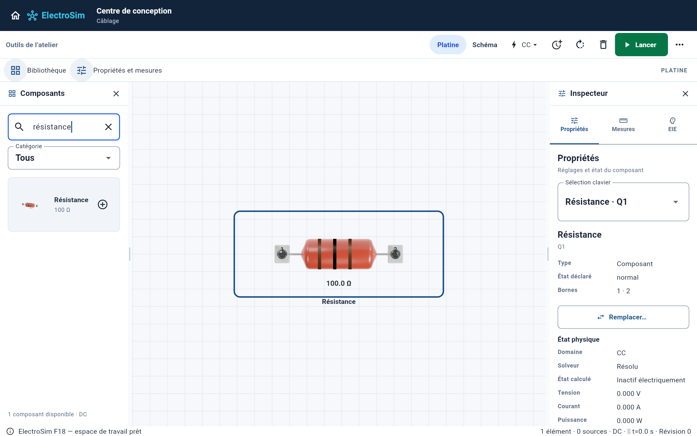
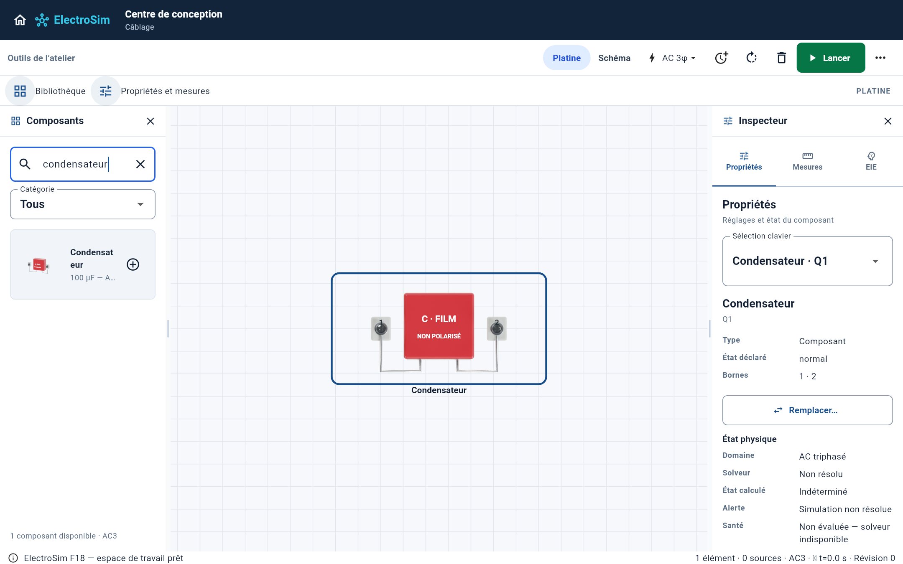
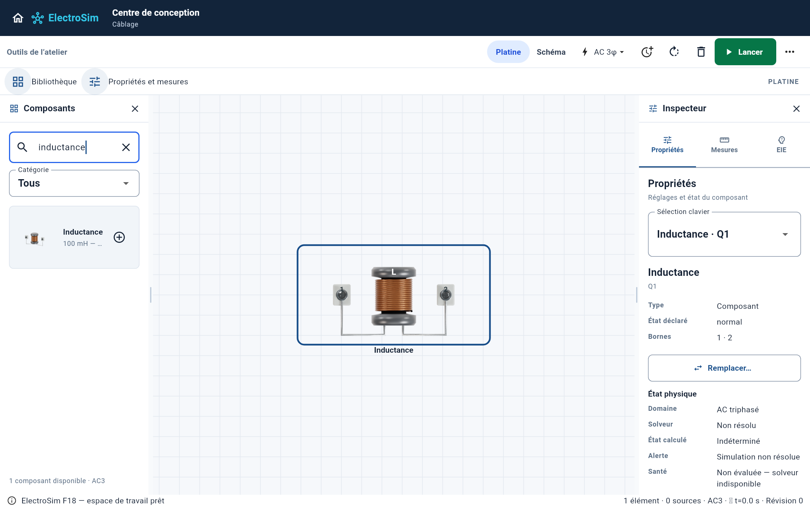

# Passifs — résistance, condensateur et inductance

Ce lot est isolé sur `feat/g5-passive-realism-20261010`, à partir du commit
`4b083fd` de la branche industrielle récente, qui a intégré la PR 72. Il ajoute trois
géométries originales Cycles : vue en perspective dans la palette, vue frontale
sur la platine métallisée. Aucune fusion n'est effectuée.

## Références inspectées

| Modèle ElectroSim | Référence de construction | Adaptation |
|---|---|---|
| `resistor` | [Vishay PR02](https://www.amplifiedparts.com/sites/default/files/uc_products/r-pr02-47k_0.png) | Corps axial enduit, épaules arrondies, fils étamés ; bandes nominales issues de la valeur simulée |
| `capacitor` | [WIMA MKS2, photo fabricant](https://www.wima.de/wp-content/uploads/media/WIMA_MKS_2.png) | Boîtier à film rouge, arêtes moulées, dessous résiné et pattes radiales formées ; absence de polarité |
| `inductor` | [Bourns RLB0914](https://www.newark.com/productimages/large/en_US/5245172.jpg) | Noyau ferrite à deux flasques, taille centrale et enroulement émaillé apparent |

La [page fabricant du condensateur](https://www.wima.de/en/our-product-range/polyester-capacitors/mks-2/)
confirme la famille à film. Le condensateur idéal du catalogue est utilisable
en AC et expose deux bornes `1/2` : le remplacer par un électrolytique polarisé
aurait ajouté une indication physique trompeuse.

Les trois photos ont été inspectées hors dépôt. Elles ne sont pas intégrées
comme textures. Les boîtiers sont des adaptations génériques, avec petits
adaptateurs pédagogiques à vis qui conservent exactement les coordonnées de
connexion existantes. L'enveloppe de présentation est celle du contrat Canvas,
pas une échelle dimensionnelle certifiée de ces pièces commerciales.

Le condensateur n'emprunte ni le marquage 3,3 µF ni la tension 50 V de la photo.
L'inductance simulée n'est pas calculée à partir des tours visibles : sa valeur
reste un paramètre du moteur électrique. La photo à 100 µH ne qualifie pas la
construction d'une inductance de 100 mH. Aucune marque fabricant n'est apposée.

## Valeurs et protection du fonctionnement

La résistance reçoit la valeur de l'instance sur la platine et la valeur
nominale de la définition dans la palette. Les trois bandes affichent deux
chiffres et le multiplicateur ; aucune tolérance fabricant n'est modélisée.
Si une valeur n'est pas représentable exactement par ce code, les bandes sont
omises et le texte conserve la valeur numérique. Une donnée non finie ne
produit pas un code trompeur. Le rendu se met à jour lorsque la valeur change.

Les dimensions, identifiants et positions des ports sont inchangés. Les tests
comparent le manifeste au contrat Canvas et vérifient que chaque point de
raccordement tombe dans l'empreinte de sa vis. Les modèles électriques,
protections, routage, persistance, rails et animations existants sont conservés.

Les captures ci-dessous sont produites avec les widgets ElectroSim réels,
via `tool/capture_g5_industrial_test.dart`, sans retouche ni maquette générée.
Ces appareils passifs ne sont pas représentés comme des modules DIN.





## Reproduction

Qualification sur cette base : **544 tests application réussis**, deux tests
ignorés par la suite existante, **quatre tests de captures réussis** et analyse
Dart sans problème. La compilation Web release de `lib/main.dart` a réussi
avec les sources application et packages de cette base. Les goldens existants
n'ont pas été modifiés. Le garde `core_unify_architecture_guard.py` réussit.
Les anciens gardes F9/P1 signalent des écarts sur cette base ; ils ne sont pas
présentés comme réussis. La compilation native Mac reste à confirmer par CI.

L'[inventaire du catalogue](catalogue-status.md) distingue les 77 entrées,
les 30 entrées utilisant les plaques Cycles et les 23 géométries partagées.

Depuis `apps/electrosim` :

```bash
flutter test --no-pub test/g5_industrial_physical_assets_test.dart
flutter test --no-pub test/g5_passive_markings_test.dart
flutter test --no-pub tool/capture_g5_industrial_test.dart
```

Depuis la racine, pour les rendus originaux :

```bash
ELECTROSIM_INDUSTRIAL_MODELS=resistor-axial,capacitor-film,inductor-drum ELECTROSIM_RENDER_SAMPLES=64 blender -b --factory-startup -t 4 --python tools/render_g5_industrial.py
```

Le catalogue complet n'est pas terminé. Diodes/LED, instruments, sources/PV et
plusieurs équipements de charge conservent leurs représentations antérieures.
