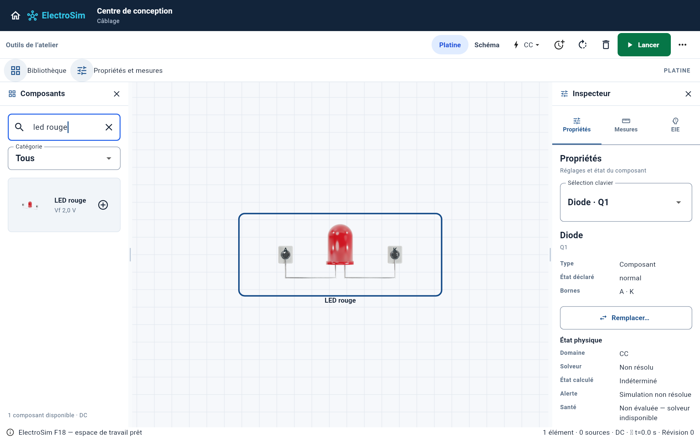
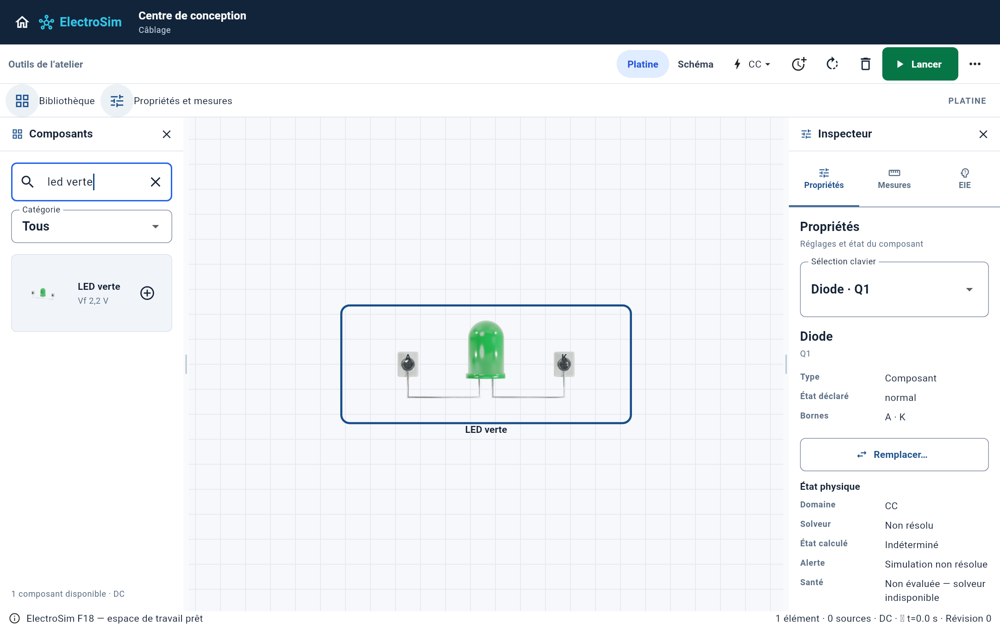
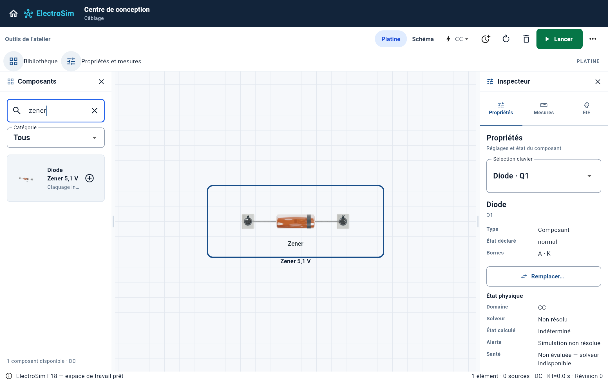
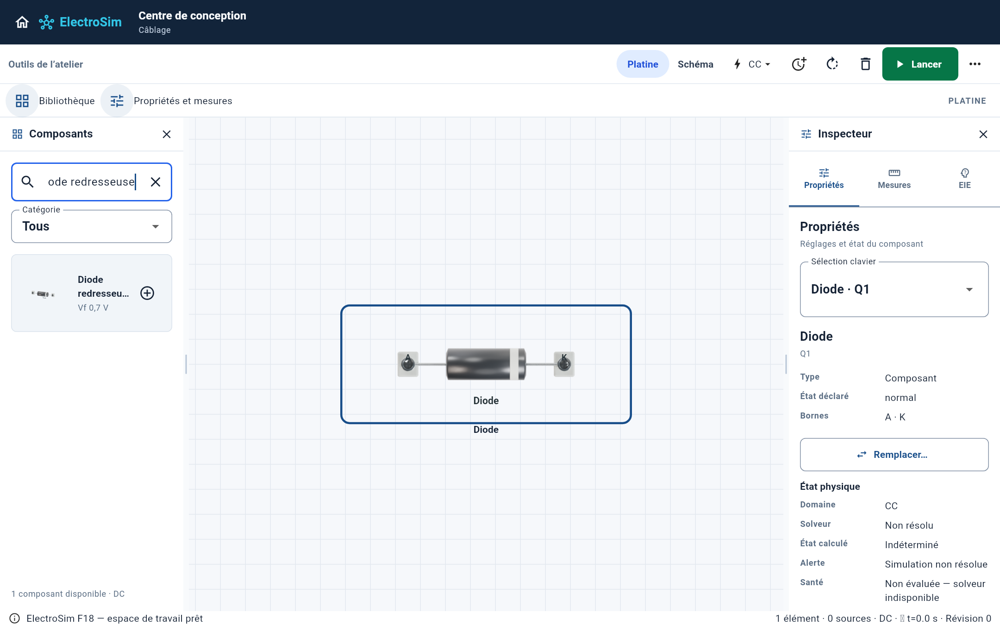
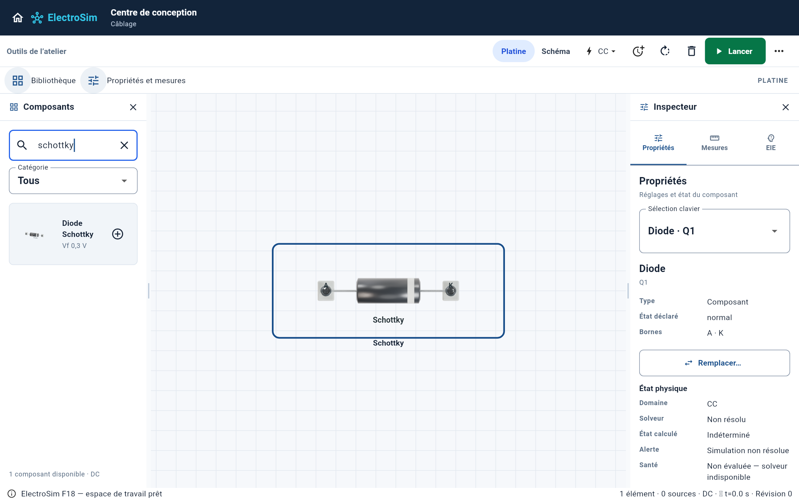
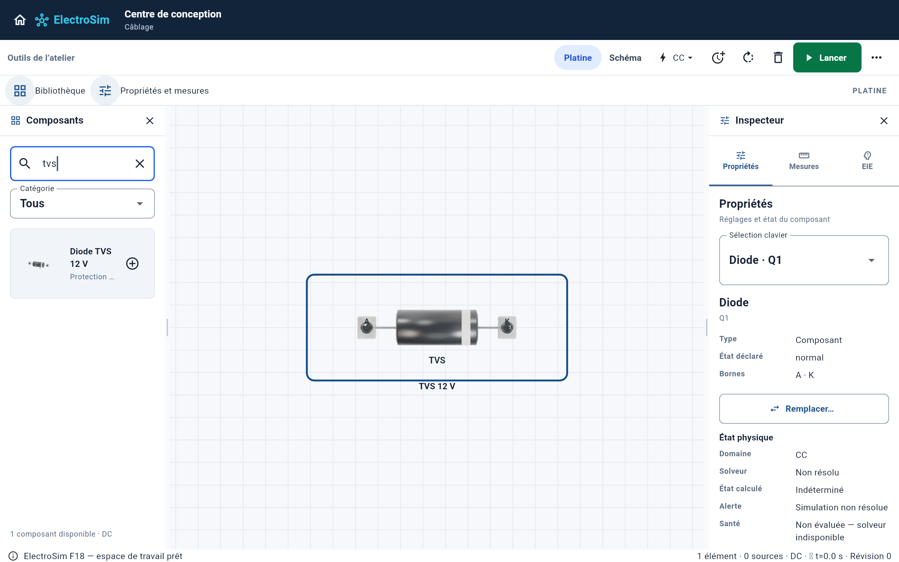

# Semi-conducteurs — six variantes, cinq géométries

Extension séparée sur `feat/g5-semiconductor-realism-20261010`, au-dessus du lot
passifs de la PR 82. Aucun changement du moteur électrique ni des paramètres
Vf, résistance série, claquage inverse ou courant maximal. Aucune fusion.

## Références photographiques inspectées

| Variante | Photo de référence | Construction du rendu générique |
|---|---|---|
| Redresseuse | [1N4007](https://core-electronics.com.au/media/catalog/product/t/-/t-118-1.jpg) | Boîtier axial moulé noir, pattes étamées, bande argentée côté K |
| Schottky | [ST 1N5819](https://media.digikey.com/photos/STMicro%20Photos/497_1N5819.JPG) | Même famille de boîtier axial ; libellé Schottky distinct |
| Zener | [BZX55C5V1](https://www.marutsu.co.jp/contents/shop/marutsu/img/goods/020/2648715/2648715_2.jpg) | Capsule ambrée en verre, électrode interne et repère sombre de cathode |
| TVS | [P6KE](https://www.electronicadiy.com/cdn/shop/files/P6KE_510x510.jpg?v=1767132370) | Corps axial moulé plus large ; repère K unidirectionnel |
| LED rouge | [Kingbright WP7113](https://assets.rs-online.com/image/upload/v1525208535/70062992.jpg) | Résine bombée rouge, collerette, face plate côté K, deux pattes |
| LED verte | [Kingbright L-7113](https://static.rapidonline.com/catalogueimages/product/55/01/s55-0120p01wl.jpg) | Résine verte et même construction radiale |

Photos téléchargées et inspectées hors dépôt ; aucune photographie commerciale
n'est utilisée comme texture. Les géométries, matériaux et éclairages sont
produits par `tools/render_g5_industrial.py`, Cycles, 64 échantillons.
Les références commerciales guident les formes ; leurs marques, numéros et
caractéristiques nominales ne sont pas copiés sur les composants simulés.

## Connexions et états

Les six variantes restent des modèles `diode` avec le même contrat Canvas :
270 × 105 unités de présentation, A à gauche et K à droite. Les petites pinces
pédagogiques conservent les coordonnées de raccordement existantes ; elles ne
font pas partie du boîtier commercial. Ces dimensions ne certifient pas une
échelle physique réelle ni une identité photographique à 100 %.

La sélection de géométrie utilise `_visualVariant`. Une LED ne reçoit jamais
le boîtier axial par défaut. Chaque modèle charge ses deux vues atomiquement :
une variante absente conserve le rendu antérieur. Une variante inconnue ne
reçoit pas arbitrairement une autre identité.

La lumière des LED suit l'état `energized` transmis par le rendu de production.
Aucun clignotement, courant ou puissance électrique n'est inventé. Le test
compare les pixels éteint → alimenté → éteint : le halo doit apparaître puis
l'image initiale doit être retrouvée. Il vérifie aussi l'identité de chacune
des six variantes de la palette réelle.

Les captures ci-dessous utilisent `F9WorkspaceDemoPage` et les widgets de
production. Elles montrent des composants isolés, simulation arrêtée ; elles
ne prétendent pas qualifier un circuit alimenté. Perspective dans la palette,
face avant sur la platine, sans montage photo ni retouche.








## Qualification

546 tests application réussis, deux ignorés par la suite existante ; quatre
tests de capture réussis ; analyse Dart sans problème ; build Web release de
`lib/main.dart` réussi ; garde CORE-UNIFY réussi. Aucun golden modifié.
Les anciens écarts F9/P1 signalés dans le lot passifs ne sont pas corrigés ou
présentés comme qualifiés ici. La compilation Mac Intel est confiée au workflow
spécifique de cette branche ; son résultat reste à confirmer.

```bash
# Depuis apps/electrosim
flutter test --no-pub test/g5_semiconductor_visuals_test.dart
flutter test --no-pub test/g5_industrial_physical_assets_test.dart
flutter test --no-pub tool/capture_g5_industrial_test.dart
```

Le catalogue entier n'est pas terminé : instruments, sources/PV et plusieurs
équipements de charge conservent leurs rendus précédents.

Le [lot sources/PV](../g5-source-pv-ten/README.md) poursuit cet inventaire ;
les chiffres ci-dessus décrivent la qualification historique de ce lot.
